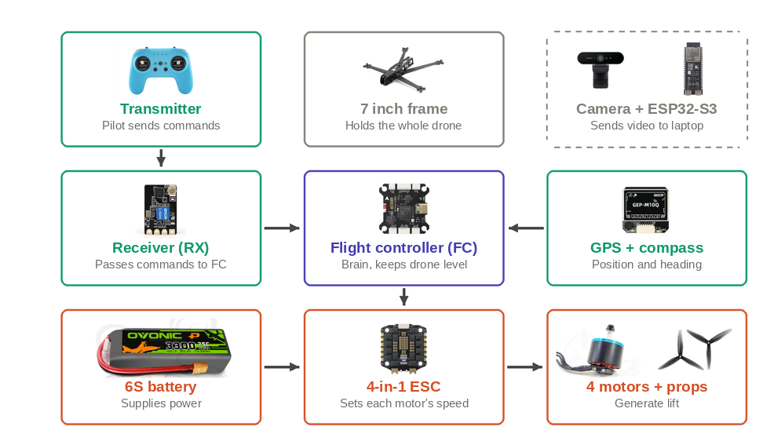
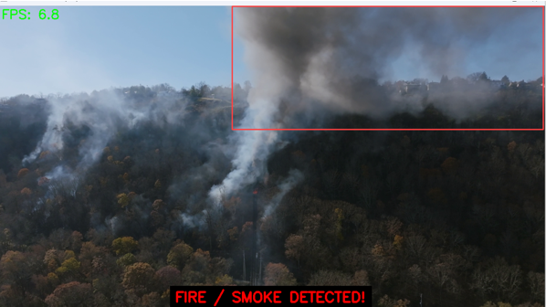

# Edudrone: Build Log

A build log of an open-hardware FPV drone, from a first 5 inch build to RapidScout, a drone I am building to help spot smoke and fire from the air.

## At a glance

| | |
|---|---|
| **What it is** | A build log and code for an open-hardware FPV drone that I assembled from individual parts so every component can be opened up and explained, and for its next stage, RapidScout, a low cost scouting drone that I am building to spot fire and smoke. |
| **What it does** | A USB camera on an ESP32-S3 board sends video to a laptop, which runs a [public YOLO fire and smoke detection model](https://universe.roboflow.com/sayed-gamall/fire-smoke-detection-yolov11) on its GPU and raises an alert. The plan is to carry the camera on the drone. For now it runs on the bench and is not mounted on the drone yet. Planned next: tag each detection with a GPS position and fly a pre-mapped route. The drone only reports, it does not act on its own. |
| **Built with** | A [7 inch long range frame](#the-7-inch-build), a GEPRC Taker H743 BT flight controller ([manual](docs/TAKER-H743-BT-FC-Manual.pdf)) running INAV, a GEPRC GEP-M10Q GPS, an ExpressLRS radio link, a USB camera on an ESP32-S3 that [streams video over WebSocket](#camera-and-ai-detection-over-websocket) (so far on the bench, not yet mounted on the drone), and a laptop with an NVIDIA RTX 3050 GPU running Python with ONNX Runtime and Roboflow Inference. |
| **The code** | One Python program, [`code/fire_smoke_detection.py`](code/fire_smoke_detection.py). It receives JPEG frames from the ESP32 over WebSocket, runs the Roboflow fire and smoke model on the GPU with ONNX Runtime, applies a separate confidence threshold to each class, draws boxes and a frame rate counter, and raises a flashing red alert after 3 detections in a row. It checks that the model really runs on the GPU, reconnects by itself when the video drops, and can use the laptop's webcam for testing. |
| **My role** | Chose the parts, soldered the electronics, flashed and configured the flight controller, rebuilt the drone on a 7 inch frame after an ESC failure, and wrote the detection program. I did not train the detection model, it is a public one. |
| **Status** | Work in progress. The 7 inch drone is built. Video streaming and fire and smoke detection work on the laptop, tested with the camera on the bench. The camera and ESP32-S3 are not mounted on the drone yet, so the video link has not been tested in flight. Reading GPS data to tag detections is [in progress](#currently-working-on). Flying a pre-mapped route and a ground station screen are not done yet. |
| **In this repo** | The build log below ([Phase 1](#phase-1-edudrone---how-i-chose-my-setup) is the 5 inch Edudrone, [Phase 2](#phase-2-rapidscout---giving-the-drone-a-mission) is RapidScout), the detection program in [`code/`](code/), a hardware diagram and screenshots in [`images/`](images/), and the flight controller manual in [`docs/`](docs/). |
## Phase 1: Edudrone - How I Chose My Setup

### Choosing a Drone Class: Microdrone, Freestyle, or Long Range

FPV drones are usually grouped by propeller size, and that size roughly decides what the drone is good at.

A microdrone, or whoop, runs 1 to 2 inch propellers. It's small, light, safe to fly indoors, and forgiving for someone just learning the sticks.

A freestyle drone runs 5 inch propellers, sometimes 4 or 6 inch. This is the class most people picture when they think FPV: fast, agile, built for tricks and tight maneuvering.

A long range drone runs 7 inch propellers or bigger. Bigger props move more air per rotation, so the drone trades some agility for efficiency and flight time, which is what long range is actually for.

Edudrone started as a freestyle build, 5 inch propellers, and only later moved toward long range once the mission changed.

### Practice Phase: Meteor65 Pro

Before committing to real parts, I bought a Meteor65 Pro and a RadioMaster controller, not to fly for fun but to practice the fundamentals: flashing firmware onto a flight controller, binding a receiver to a transmitter, basic tuning.

I got the version without a camera and VTX, since I wanted to practice flying and tuning rather than FPV racing. If you're using a RadioMaster 2.4GHz ELRS controller like I am, pick the ELRS 2.4G RX version.

### Core Hardware: What Are ESC and FC

Before picking parts, it helps to know what a 5 inch drone actually needs underneath.

The ESC, or Electronic Speed Controller, usually comes as a "4-in-1" board that controls all four motors' speed based on signals from the flight controller.

The FC, or Flight Controller, is the brain. It runs firmware like INAV, Betaflight, or ArduPilot, reads data from the gyroscope, accelerometer, GPS, and compass, and sends output commands to the ESC.

### What I Actually Chose (5 inch build)

Stack: GEPRC Taker H743BT flight controller. The ESC was originally the stock one bundled with the stack, but I later replaced it with a Flywoo GOKU G55M 55A 4-in-1 ESC after solder damage (more on that below).

Motor: AxisFlying 1960KV.

Receiver: GEPRC ELRS.

GPS module: GEPRC GEP-M10Q

### Soldering: Temperature and Technique

The cheap soldering iron I first bought from the market couldn't get solder to flow evenly onto a pad no matter what I tried. I switched to an FNIRSI HS-01 (the HS-02 has more features if you want them), and while I was still getting used to the new iron, I ruined my first ESC: solder smeared around the board instead of sitting cleanly on the pad. That mistake also took out my GPS module and receiver, damaged by the same bad soldering job.

Motor pads need around 350°C, ESC pads around 400°C. Pre-tin the wire and the pad separately, apply flux first, and use 63/37 solder since it sets fast and leaves fewer cold joints.

I ended up replacing the damaged ESC with a Flywoo GOKU G55M 55A 4-in-1, which has a pad-hole design that makes soldering noticeably easier than the stock board.

One small trick: if a motor spins the wrong direction, you can reverse it by swapping any two of the three motor-to-ESC wires, no need to re-flash anything.

Safety tip: always route the first battery plug-in after soldering through a smoke stopper. If there's a short, you'll know before anything burns.

### Flashing Firmware: Starting with Betaflight, Then Switching to INAV

Flashing firmware on the GEPRC Taker H743BT works the same whether you're using Betaflight or INAV. Here's the process I followed:

1. Open the Board & Build tab in the firmware flasher and select the exact target, GEPRC_TAKER_H743. It shows a "Community/Manufacturer supported, not officially supported" warning, which is normal for this board.
2. In Build Configuration, set Radio Protocol to CRSF and Motor Protocol to DSHOT.
3. Match the other options (GPS, Optical Flow, Pin IO, Range Finder, VTX) to your actual hardware.
4. Go to the Flash tab, choose Load Firmware [Online], then Flash Firmware.
5. Verify the flash worked by checking gyro and accelerometer response in the Setup tab.

I flashed Betaflight first, then flashed INAV onto the same board using the exact same steps.

Betaflight doesn't have Position Hold mode, by design, since it's built for manual, freestyle, and racing flight. INAV does have it. Since RapidScout needs the drone to hold a stable position over a target, switching to INAV wasn't optional. It was a requirement, not just curiosity about trying a different firmware.

### FC Setup: Receiver and GPS

On the Receiver tab, set Receiver Mode to Serial (via UART), Serial Receiver Provider to CRSF, and enable Serial RX on UART2. My receiver is a GEPRC ELRS, which needs an ELRS 2.4GHz transmitter to bind to.

For GPS, connect it to UART4, set Sensor Input to GPS, and set the baud rate to 115200.

[](/Quannguyen-0512/Edu-Drone-/blob/main/images/gps-setup.png)

### First Test Flight and Tuning

If you're used to the gentle feel of a small DJI Tello, switching to a 5 inch drone like mine, you might be a little shocked by how sensitive the yaw stick is.

The first skill worth learning is hovering the drone in one spot. For beginners, I'd recommend bringing the motor output limit down to around 80-90%, and flattening the Expo curve so it's less steep near the center of the stick. This keeps the drone calmer for small corrections while still letting you reach full rotation rate at full stick deflection. You'll find this under the Rates tab in Betaflight, or the Rate profile in INAV.

---

## Phase 2: RapidScout - Giving the Drone a Mission

### From Edudrone to RapidScout

After I got the drone flying, I had an idea: fly the drone at altitude, scan the ground below with a camera, and detect smoke and fire. The camera would send its video to a laptop on the ground, which runs a public fire and smoke detection model and raises an alert when it finds something. The drone doesn't take any action on its own, it just reports.

The full plan also has the drone fly a pre-mapped GPS route and tag every detection with a GPS position, so a human operator knows where to go. This is where each part stands today.

| Part | Status |
|---|---|
| 7 inch long range drone running INAV | Built |
| Video from a USB camera, through an ESP32-S3, over WebSocket to the laptop | Working, tested on the bench |
| Fire and smoke detection on the laptop GPU, with an on-screen alert | Working |
| Mounting the camera and ESP32-S3 on the drone and testing the link in flight | Not done yet |
| Reading GPS data from the flight controller to tag detections | In progress |
| Flying a pre-mapped GPS route | Not done yet |
| Ground station interface with the drone's position | Not done yet |

To make that happen, the first thing I needed was a drone that could fly steady, hold its position well, and stop drifting.

### The ESC Incident

With the drone flying, I wanted to smooth it out further before mapping any routes. Mid test flight, I noticed a strange pattern: holding the throttle steady, motors 1 and 4 would drop their output while motors 2 and 3 spiked up, one diagonal pair moving opposite the other.

I opened AM32 Configurator to check the ESC parameters, motor KV, poles, timing. I adjusted the values and hit Save, but after a power cycle, none of it had actually changed. I tried again, checking all four ESCs this time, same result. Then I checked Stuck Motor Protection, and all four ESC status icons flipped from green to red, stuck in Bootloader.

I didn't stop to figure out why. I moved straight to Flash Firmware instead.

The target dropdown showed NOT FOUND, no auto-detection. I looked up the exact part printed on the ESC, a Flywoo GOKU G55M 128K 3-6S 55A, and cross-referenced it against AM32's firmware source on GitHub, the targets.h file, to find the right target manually.

I found a GitHub issue on INAV describing a bug where the flight controller blocks passthrough writes to the ESC, which matched what I was seeing. I backed up the entire INAV configuration first with the CLI diff all command, gyro and accelerometer calibration, PID profiles, the mixer, pin profiles, so I could restore everything exactly no matter what happened next. Then I flashed Betaflight onto the FC to isolate the variable, confirming the target as GEPRC_TAKER_H743.

Flashing the ESC through Betaflight produced the exact same stuck-at-Sending result. [](/Quannguyen-0512/Edu-Drone-/blob/main/images/am32-bootloader-error.png)

I decided to stop experimenting on the main board while it still worked, and went looking through what I already had. I found a spare GEPRC 4-in-1 board I'd set aside, which had a single unrelated bad XT60 solder joint from earlier.

I managed to resolder a spare GEPRC ESC, and verified it with a smoke stopper and a multimeter across the XT60 pads. But I'd put all my attention on the big XT60 pad and soldered the motor wires more carelessly, figuring a smaller pad meant no risk of a cold joint. The cold joint was hidden inside, looking fine from the outside, and a static continuity test didn't catch it. When I pushed the throttle to max to test the motors, the strong vibration snapped the wire loose from the joint, causing a short and burning the circuit.

Since the motor set was ruined anyway, I decided to use the moment to move up to a 7 inch long range frame, lower KV motors for steadier flight, more room to carry electronics, and longer range.


### The 7 Inch Build

The ESC incident ended the 5 inch build, so I rebuilt on a 7 inch long range frame. The bigger frame has room to carry more sensors, and lower KV motors with larger propellers are more efficient for longer flights. The new build keeps the GEPRC Taker H743 BT flight controller and the same GPS and receiver models as before, with a new frame, motors, propellers, ESC, and battery. Smaller parts such as propeller ducts are 3D printed. The parts I bought new cost about 6.8 million VND in total.

[](images/rapidscout-hardware-diagram.png)

*How the parts connect. The camera and ESP32-S3 have a dashed border because they are a separate payload that only sends video to the laptop. They are not mounted on the drone yet.*

| Part | What I used | Notes |
|---|---|---|
| Frame | TBS Source One V6 7" DC | 313 mm diagonal, 173 g |
| Motors | ZTM 2807 1300KV (x4) | Lower KV than the 5 inch build |
| Propellers | Gemfan Hurricane 7050, 3 blade (x4) | 7 inch diameter, 5 inch pitch |
| ESC | GEPRC Taker H65 8S 65A 4-in-1 | 65 A continuous, 3S to 6S when stacked with the FC |
| Battery | Ovonic 3300mAh 6S 75C, XT60 | 22.2 V |
| Flight controller | GEPRC Taker H743 BT | STM32H743, runs INAV |
| GPS | GEPRC GEP-M10Q | u-blox M10 chip with a compass, 10 Hz |
| Receiver | GEPRC ELRS Nano 2.4G | ExpressLRS |
| Transmitter | RadioMaster T8L | ELRS 2.4 GHz |
| Camera and link | USB camera and ESP32-S3 | Not mounted on the drone yet. See the next section |

The heavier frame needs bigger motors, bigger motors draw more power, and a bigger battery adds weight again. I chose the 3300 mAh pack because it seemed enough, and I have not yet worked out how long the drone flies on it.

### Camera and AI Detection over WebSocket

**Status.** So far I have run this on the bench. The camera and the ESP32-S3 sit on my desk and stream to the laptop. They are not mounted on the drone yet, so I have not tested the video link, its range, or the image quality in flight.

The detection does not run on the drone. A USB camera plugs into the USB port of an ESP32-S3 board, which reads each JPEG frame and sends it to the laptop over WiFi using a WebSocket. The laptop runs the detection model on its GPU and shows the annotated video.

```
USB camera --> ESP32-S3 --(WiFi, WebSocket, JPEG frames)--> Laptop (GPU) --> annotated video + alert
```

The Python program is in [`code/fire_smoke_detection.py`](code/fire_smoke_detection.py). It connects to the ESP32-S3's WebSocket address (set in `CAMERA_WS_URL`), decodes each frame with OpenCV, runs the model, and draws boxes, labels, and a frames-per-second counter. If the connection drops, or no frame arrives for 5 seconds, it reconnects and keeps retrying every 2 seconds. Setting `VIDEO_MODE = "webcam"` lets you test the same program with the laptop's own webcam, without the ESP32.

**The model.** I did not train this model. I use Fire-Smoke-Detection-Yolov11 by Sayed Gamall, published on Roboflow Universe under CC BY 4.0. It detects two classes, fire and smoke. According to its page it was trained on 10,463 images (9,156 for training, 872 for validation, and 435 for testing) and scores 76.8% mAP@50, 80.3% precision, and 73.2% recall. Training a model of my own is hard because I have no good dataset.

**Running it on the GPU.** The model runs through ONNX Runtime with CUDA. A missing library can make ONNX Runtime fall back to the CPU without telling you, so the program checks that the model really is on the GPU and stops with an error if it is not. My laptop has an NVIDIA GeForce RTX 3050 Laptop GPU, with Python 3.12, ONNX Runtime GPU, Roboflow Inference, OpenCV, Supervision, and websocket-client.

**Reducing false alarms.** The model's general threshold is 0.25, then each class has its own, 0.35 for fire and 0.3 for smoke. The alert only turns on when fire or smoke appears in 3 frames in a row, and it stays on for 1.5 seconds after the last detection. The alert is a flashing red overlay with a warning text, plus a beep on Windows. Press `q` to quit and `t` to test the alert.

[](images/detection-demo.png)

*A test run of the detection program on a pre-recorded video of smoke over a forested hillside, not on footage from my own drone. The program draws a box around the smoke it found and shows the frame rate (the counter reads 6.8 FPS in this frame). The red banner appears once fire or smoke has been detected in 3 frames in a row.*

To run it, set your own Roboflow API key as an environment variable and start the program. The first run needs internet to download the model, and later runs work offline. Never put the key in the code.

```
$env:ROBOFLOW_API_KEY = "your-key-here"     # PowerShell
python code/fire_smoke_detection.py
```

It only works on visible light video in daylight, because the camera is a plain USB camera and not a thermal one. WiFi will also limit how far the drone can be from the laptop, which I have not measured yet.

### Currently Working On

The next step is to mount the camera and ESP32-S3 on the drone and test the video link in flight. I am also reading GPS data from the flight controller over MSP with an ESP32-S3, so every detection can be tagged with a location. After that comes flying a pre-mapped GPS route, and a ground station screen that shows the drone's position next to the video.

### What Comes Next

The drone's own position is not the same as the fire's position. I want to estimate where the fire really is from the flight altitude, the camera angle, and where the fire appears in the frame. I also want to add images of small fires and local forest scenes to improve the model, and to replace WiFi with a longer range link.

---

## Repository layout

| Path | Contents |
|---|---|
| `code/fire_smoke_detection.py` | Fire and smoke detection program that receives video over WebSocket |
| `docs/` | GEPRC Taker H743 BT flight controller manual |
| `images/` | Photos and screenshots used in this log |

## References

1. [GEPRC Taker H743BT FC Manual](https://github.com/Quannguyen-0512/Edu-Drone-/blob/main/docs/TAKER-H743-BT-FC-Manual.pdf)
2. [Fire-Smoke-Detection-Yolov11 (Roboflow Universe, Sayed Gamall, CC BY 4.0)](https://universe.roboflow.com/sayed-gamall/fire-smoke-detection-yolov11)
3. [Meteor65 Pro II O4 Brushless Whoop Quadcopter](https://betafpv.com/products/meteor65-pro-ii-o4-brushless-whoop-quadcopter?variant=44067835084934)
4. [Flywoo GOKU G55M 32bit 128K 3-6S 55A 4-in-1 ESC](https://www.defiancerc.com/products/flywoo-goku-g55m-32bit-128k-3-6s-55a-4-in-1-esc-30x30)
